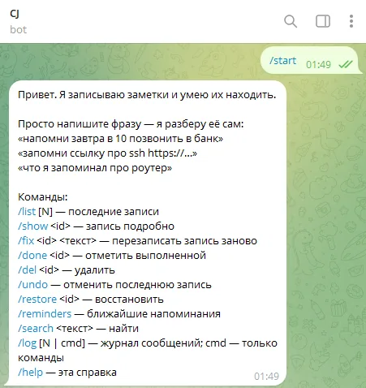
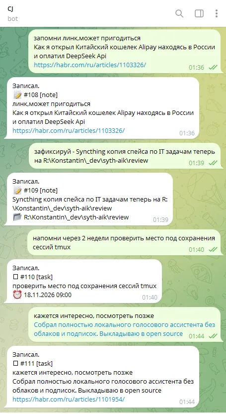
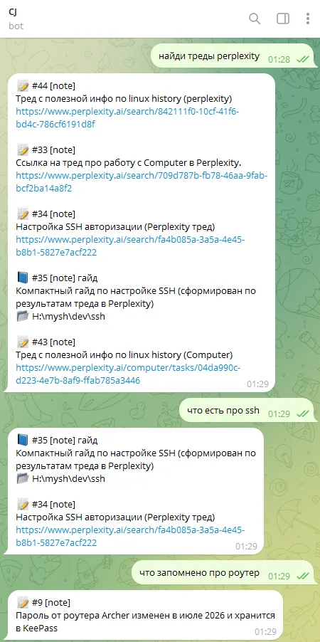
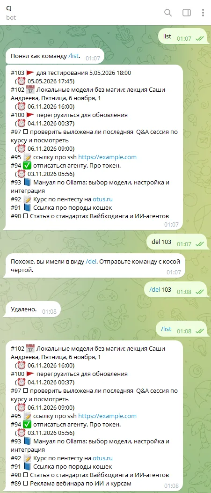

## Пример результата для проекта "Персональный ИИ-ассистент для заметок и напоминаний" (MVP v2)

Ниже — снимки экрана второй версии бота:

- знакомство: бот отвечает на `/start` и показывает, что умеет;
- сохранение: фразы превращаются в записи разных типов, ссылки и время извлекаются автоматически;
- поиск: запросы на естественном языке, работают синонимы и связи сущностей;
- команды: распознавание команды без косой черты и защита от случайного удаления.

📌 _Кликните уменьшенное изображение чтобы посмотреть полноразмерный скриншот_

| знакомство ➡️ | сохранение ➡️ | поиск ➡️ | команды |
| ----------------------------- | ------------------------------ | ------------------------------ | ------------------------------ |
|  |  |  |  |

## Описание проекта второй версии

[README.md](README.md)
